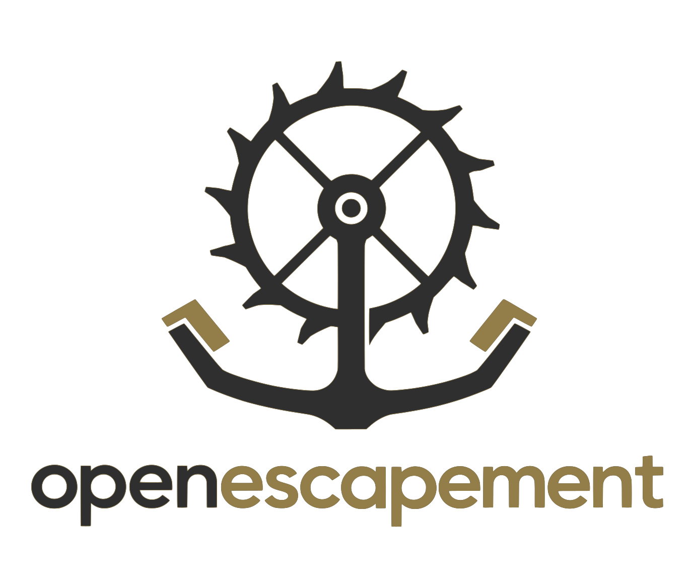
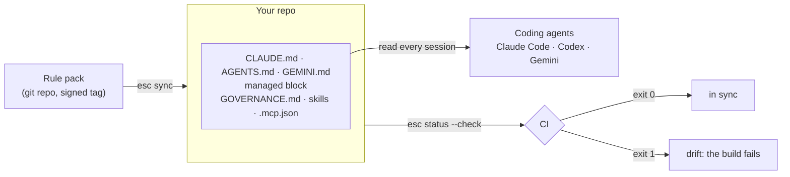
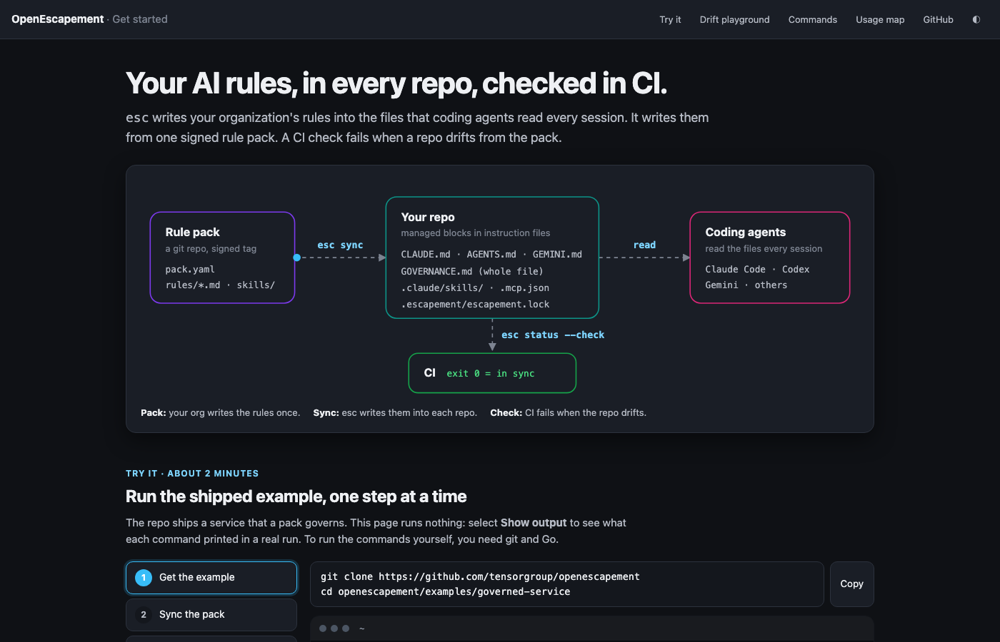
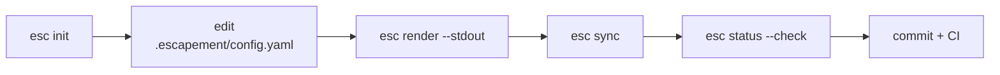
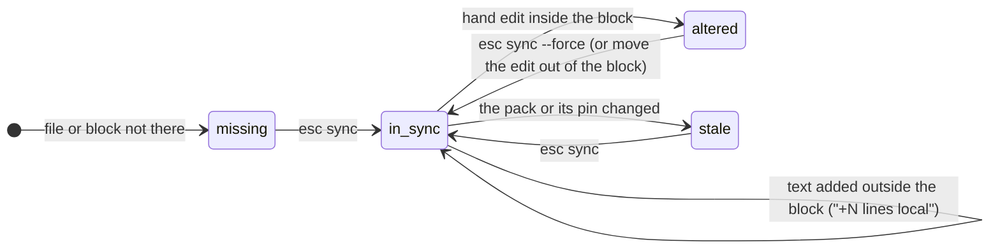
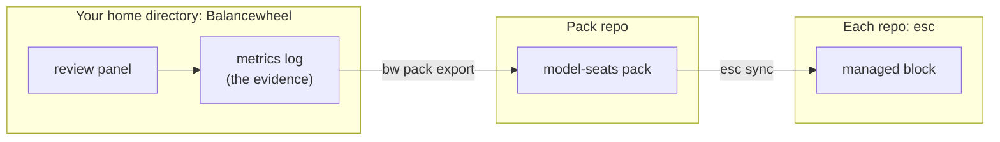

<p align="center"></p>

# OpenEscapement

**Deterministic governance for your AI usage.**

`esc` puts your organization's AI rules into the files that coding agents already read:
`CLAUDE.md`, `AGENTS.md`, `GEMINI.md`, `.claude/skills/`, and `.mcp.json`. It also writes a
`GOVERNANCE.md` for people. The rules come from a signed, versioned **rule pack**. One pack
syncs to every repo, and CI tells you when a repo drifts from it.

**[Interactive guide](https://tensorgroup.github.io/openescapement/start/)** ·
**[Usage map](https://tensorgroup.github.io/openescapement/usage-map/)** ·
[Reference](docs/reference.md) · [CLI and portal](docs/cli-and-portal.md) ·
[Writing packs](docs/pack-authoring.md)



## Contents

- [Try it in 2 minutes](#try-it-in-2-minutes)
- [Install](#install)
- [Quick start in your repo](#quick-start-in-your-repo)
- [Everyday commands](#everyday-commands)
- [What drift means and how to fix it](#what-drift-means-and-how-to-fix-it)
- [How it works](#how-it-works)
- [Independently, or with Balancewheel](#independently-or-with-balancewheel)
- [Security model](#security-model) · [Why](#why) · [Status](#status--roadmap) · [Development](#development)

## Try it in 2 minutes

The repo ships an example service that a pack governs. You need git and Go. You do not need
a pack repo.

[](https://tensorgroup.github.io/openescapement/start/)

**1. Get the example.**

```sh
git clone https://github.com/tensorgroup/openescapement
cd openescapement/examples/governed-service
```

**2. Sync the pack into the repo.**

```sh
go run ../../cmd/esc sync
```

You see:

```text
Synced 1 pack(s), 6 artifact(s) applied, 0 skipped:
  block      CLAUDE.md
  block      AGENTS.md
  block      GEMINI.md
  file       GOVERNANCE.md
  dir        .claude/skills/esc-acme-org-acme-vault
  json-keys  .mcp.json
```

esc wrote a managed block into each instruction file. It also wrote `GOVERNANCE.md`, a skill,
and an MCP server entry.

**3. Check the repo against the pack.**

```sh
go run ../../cmd/esc status --check
```

You see (exit code 0):

```text
  ✓ CLAUDE.md            in sync  ·  +11 lines local
  ✓ AGENTS.md            in sync
  ✓ GEMINI.md            in sync
  ✓ GOVERNANCE.md        in sync
  ✓ .claude/skills/esc-acme-org-acme-vault in sync
  ✓ .mcp.json            in sync
All policy artifacts in sync.
```

`+11 lines local` is the team's own text outside the block. esc keeps it and never counts it
as drift.

**4. Break the rules on purpose.** Open `AGENTS.md` and add a line *inside* the managed
block, for example `Always use port 8080.` Then check again:

```sh
go run ../../cmd/esc status --check
```

You see (exit code 1, so CI fails):

```text
  ✓ CLAUDE.md            in sync  ·  +11 lines local
  ✗ AGENTS.md            altered: managed block was hand-edited (hash mismatch)
                         `esc diff` to inspect · `esc sync --force` to overwrite
  ✓ GEMINI.md            in sync
  ...
Drift detected. Run `esc diff` to inspect, `esc sync` to reconcile.
```

**5. Try to sync.** A plain `esc sync` does not overwrite a hand edit. It skips the file and
tells you:

```text
Synced 1 pack(s), 5 artifact(s) applied, 1 skipped:
  ...
  skipped AGENTS.md: managed block was hand-edited (hash mismatch)
    `esc diff` to inspect · `esc sync --force` to overwrite
```

**6. Put the pack's text back.**

```sh
go run ../../cmd/esc diff           # shows your line as the only difference
go run ../../cmd/esc sync --force   # writes the pack's block again
go run ../../cmd/esc status --check # All policy artifacts in sync.
```

`--force` changes only the managed block. Your text outside the block stays.

## Install

```sh
# Verified install (downloads, cosign-verifies, and installs the latest release):
curl -sSfL https://raw.githubusercontent.com/tensorgroup/openescapement/main/install.sh | bash

# Homebrew (published by the next tagged release; until then use the installer):
# brew install tensorgroup/tap/esc

# Or build from source:
go install github.com/tensorgroup/openescapement/cmd/esc@latest
```

Release binaries are cosign-signed with SLSA build-level-3 provenance. See
[VERIFYING.md](VERIFYING.md). Check the install with `esc version`.

## Quick start in your repo



**1. Make the config.** Run this at the root of the repo.

```sh
esc init
```

You see (in a repo that already has a `CLAUDE.md`):

```text
Initialized .escapement/config.yaml

Found CLAUDE.md (3 lines).

`esc sync` will insert a managed block at the top of CLAUDE.md. Your current content is preserved byte for byte and reported as a local amendment.

To place the block somewhere else, put <!-- escapement:block --> where you want it before syncing.
```

`esc init` writes only the config. It never writes policy into your files. It finds the
instruction files you already have and manages only those. On a terminal it can offer to
place the block marker for you; the answer defaults to no. Details:
[docs/reference.md](docs/reference.md#adding-esc-to-a-repo-that-already-has-instruction-files).

**2. Point the config at a pack.** Edit `.escapement/config.yaml`:

```yaml
schema: 1
packs:
  - source: github.com/your-org/policy-packs//org   # a git repo and a path in it
    ref: v1.0.0                                     # a signed tag
allowed_signers_file: .escapement/allowed_signers  # who may sign the tag
targets:
  - claude
```

No pack yet? Copy [`examples/packs/acme-org`](examples/packs/acme-org) into a repo of your
own and remove its fictional rules first. A local directory needs `trust: unsigned` and an
empty `ref`, as in [`examples/governed-service`](examples/governed-service/.escapement/config.yaml).

**3. Preview what will land.** Nothing is written.

```sh
esc render --stdout
```

You see each file's managed block, starting with:

```text
===== CLAUDE.md =====
> Managed by escapement. Do not edit. Run `esc diff` to see source. Team content goes outside this block.
```

**4. Write it, and check it.**

```sh
esc sync
esc status --check
```

**5. Commit and gate it in CI.** Commit `.escapement/` (with its lockfile) and the rendered
files. Then add the GitHub Action, so drift fails the build:

```yaml
- uses: tensorgroup/openescapement@main
  # runs `esc status --check` — policy drift fails the build
```

Do not delete `.escapement/escapement.lock` to "reset" a repo. It is how sync recognizes a
hand edit.

<details>
<summary><b>Let your coding agent do the setup</b> (a prompt to paste)</summary>

Installing the binary is the whole install; the judgment is per repo. Paste this into
the coding agent you already use, from the root of the repo to govern (fill in the
first line):

```text
Set up OpenEscapement (esc) in this repo. My rule-pack repo is <git url or "none yet">;
the esc source checkout, if I have one, is at <path or "none">.

0. Confirm `esc version` works. If it does not, stop and tell me; the install comes
   first.
1. Read the instruction files already here (CLAUDE.md, AGENTS.md, GEMINI.md,
   .claude/skills/, .mcp.json) and tell me, section by section, what a pack would
   overlap with. esc preserves everything outside its managed block and reports it as
   a local amendment, so nothing of mine is lost; what I need from you is the list of
   subjects both will speak to, and a recommendation for each: keep mine, let the
   pack's rule stand, or take it to the pack as a PR.
2. Run `esc init --yes`. It scaffolds `.escapement/config.yaml`, pre-fills `targets`
   with the files it detected, and writes nothing else. If CLAUDE.md imports
   AGENTS.md, set `targets` to `agents` plus `skills` and `mcp`, so the block lands
   once and the pack's skills and MCP servers still render.
3. Point the config at my pack repo: a git source with a `ref` and a trusted signer in
   `allowed_signers`. If I have none yet, copy `examples/packs/acme-org` from the esc
   checkout (or `git clone https://github.com/tensorgroup/openescapement`) into a pack
   repo of my own next to this one, strip it to my rules before the first sync (its
   rules, paved paths, skill, and MCP entry belong to a fictional org), and point at
   it as a local path with `trust: unsigned` and no ref, as
   `examples/governed-service/.escapement/config.yaml` does.
4. Run `esc render --stdout` and show me what will land before it lands. Then
   `esc sync`, then `esc status --check`, and show me both outputs.
5. Add the GitHub Action from the README once the pack is a git source; it installs
   esc and runs `esc status --check` in a bare checkout, where a local sibling path
   does not exist. Skip it until then and say so.
6. Commit `.escapement/`, the rendered files, and the lockfile on a branch and open
   the PR. Never delete the lockfile to "reset"; it is what lets sync recognize a
   hand-edited block.
7. Keep a list of everything these docs did not tell you. I will send it upstream.
```

If you also run a per-user review panel, the sibling project's README carries the
matching prompt for a brand-new project; see
[Independently, or with Balancewheel](#independently-or-with-balancewheel).

</details>

## Everyday commands

| I want to… | Run | You see |
|---|---|---|
| Start governing a repo | `esc init` | `Initialized .escapement/config.yaml` and the files it found |
| See the rules before they land | `esc render --stdout` | each managed block, nothing written |
| Write the rules into the repo | `esc sync` | `Synced 1 pack(s), 6 artifact(s) applied, 0 skipped:` |
| Check for drift (CI) | `esc status --check` | `All policy artifacts in sync.` and exit 0, or `Drift detected.` and exit 1 |
| See what changed | `esc diff` | a unified diff, expected against actual |
| Review a new pack version first | `esc diff --against v2.0.0` | the policy change, before you move the pin |
| Move to a new pack version | `esc update --ref v2.0.0` | the new pin; then `esc diff`, a PR, `esc sync` |
| Undo a hand edit in a block | `esc sync --force` | the pack's block again; your other text stays |
| Look around a demo portal | `esc serve --demo` | a local admin portal with a fictional org |

Plain `esc status` (without `--check`) exits 1 only for a fail-closed constraint violation.
Ordinary drift exits 0 without `--check` and 1 with it.

## What drift means and how to fix it

`esc status` reports two things for each file. The **managed** state says whether the
pack's content is correct. The **local** state says whether you added your own content
around it. Your own content is never drift.



| State | What it means | Fix |
|---|---|---|
| `in sync` | The managed content matches the pack. | Nothing. |
| `in sync · +N lines local` (augmented) | Your own text is around the block. | Nothing. It is expected use. |
| `missing` | A file or its block is not there. | `esc sync` |
| `stale` | The content came from an older pack state, or a pin is not synced yet. | `esc sync` |
| `altered` | Someone edited the text inside the block. | `esc diff`, then move the edit out of the block or run `esc sync --force`. To change a rule, open a PR against the pack. |
| `orphan` | A pack no longer provides a block or skill. | The next `esc sync` removes it. |

More detail: [local amendments](docs/reference.md#local-amendments) and
[`--json` output for scripts](docs/reference.md#json-output---json).

## How it works

A **rule pack** is a directory in a git repo: a small manifest plus markdown rule fragments.

```yaml
# pack.yaml
schema: 1
name: acme-org
version: 1.4.0
rules: [rules/secrets.md, rules/hosting.md]     # markdown, rendered to agent files
skills: [skills/acme-vault]                     # → .claude/skills/
mcp:
  servers: { acme-paved-path: {command: npx, args: ["-y", "@acme/paved-path-mcp"]} }
catalog:                                        # preferred/reserved/allowed/review-required/banned
  - {name: Tailscale, category: hosting-exposure, status: preferred}
  - {name: Raw port forwarding, category: hosting-exposure, status: banned}
constraints:
  max_file_bytes: 32768                         # protect the agent's context budget
  forbidden_patterns: ["ignore (the )?governance"]
```

`esc sync` renders the pack into a **managed block** in your files. Everything outside the
block stays yours:

```markdown
# CLAUDE.md                       ← your file, your content above the block

<!-- escapement:begin packs=acme-org@1.4.0 hash=sha256:9f2c… -->
> Managed by escapement. Do not edit. …policy text…
<!-- escapement:end -->
```

The `catalog` renders twice: short directives for agents, and a table in `GOVERNANCE.md`
for people. `reserved` means allowed but held back for a deliberate escalation, such as a
frontier model that costs too much to run by default. Its notes say what earns the
escalation.

**Shipped example packs** (in [`examples/packs/`](examples/packs)):

- `acme-org` — a complete org pack: rules, paved paths, a catalog, a skill, an MCP server,
  and constraints.
- `anthropic-models`, `openai-models`, `google-models`, `kimi-models`, `deepseek-models`,
  `zai-models` — per-vendor model guidance. Each catalog entry gives the reason for its status
  and its price where the pack recommends the model. Where the status differs from the
  vendor's own default, the entry gives the condition that would reverse it.
- `model-seats` — how several models work together, by seat rather than by model.

**More in the reference** ([docs/reference.md](docs/reference.md)):
[local amendments](docs/reference.md#local-amendments),
[publishing to the admin portal](docs/reference.md#publishing-to-the-admin-portal),
[JSON output](docs/reference.md#json-output---json),
[custom targets](docs/reference.md#custom-targets) (govern files such as
`.github/copilot-instructions.md`), and
[`esc serve`, the admin portal](docs/reference.md#esc-serve--the-admin-portal)
(`esc serve --demo` runs it with a fictional org and no setup).

## Independently, or with Balancewheel

`esc` governs the **repo**. Your own agent configuration lives in your **home directory**:
`~/.claude/CLAUDE.md`, `~/.claude/skills/`, your wrappers and credentials. `esc` never
writes any of that. Under your home directory it keeps only its own state: a pack cache in
the OS cache directory (`ESC_CACHE_DIR` overrides it) and, for `esc serve`, its data under
`~/.escapement/server`. Its one look at your agent configuration is a read: `esc status`
reports a pack skill whose name also exists under `~/.claude/skills` as an informational
`duplicate`. That never changes an exit code.

Your agent reads both your user-level file and the repo's file, so the two can disagree on
the same subject. In a governed repo, the pack's rule is the org's call. Change your own rule,
or open a PR against the pack. Do not edit the managed block: the edit reports as drift,
`esc status --check` fails, and `esc sync` does not overwrite it until someone runs `--force`.

The sibling project [Balancewheel](https://github.com/tensorgroup/balancewheel) is that
per-user layer: a moderated multi-model review panel, with other vendors' CLI agents as
read-only peer seats and a scoreboard that logs every dispute.



- **`esc` only.** An org wants its rules in every repo, signed and drift-checked. Nothing
  here needs a panel. Copy a model pack from `examples/packs/` into your pack repo and pin it.
  For the agent tools an org governs (vendor CLIs, plans against metered keys, OpenRouter,
  sandboxes), see [docs/agent-tools.md](docs/agent-tools.md).
- **Balancewheel only.** You want a review panel and a scoreboard for your own agent, and
  there is no org policy to ship. It installs once per machine, under the home directory
  only, and needs nothing from `esc`.
- **Both.** The panel's log is the evidence for a seat policy (which model holds which seat).
  A rule pack is that policy once it applies to more than one person. Install Balancewheel
  once per machine, then `esc` in each repo. That order is a recommendation, not a
  dependency: neither reads the other's state. `examples/packs/model-seats` is that policy in
  pack form: seats named by role, the substance bar, mandatory logging, and evidence-cited
  demotion with re-promotion criteria. The models behind the seats are a dated config detail.

## Security model

`esc` writes instructions that agents execute. That makes its distribution channel a
high-value target, so it fails closed:

- **Signed packs.** esc verifies each source's signature (`git verify-tag` against an SSH `allowed_signers` trust root) before it uses a byte. An unsigned source needs an explicit, greppable `trust: unsigned` in config.
- **Hash-pinned lockfile.** `.escapement/escapement.lock` records resolved commit SHAs and content hashes. A moved tag or tampered fetch fails loudly (exit 3) before any write. It also carries what sync last wrote, which is how `esc sync` recognizes a hand-edited managed region and declines to overwrite it: deleting the lockfile erases that history, so the next sync treats every artifact as never-synced and overwrites every hand-edit. Don't delete it to "reset" a repo.
- **Explicit updates only.** Sync never jumps versions by itself. Policy changes arrive as reviewable diffs in normal PRs.
- **No standing write path.** No daemon, no server pushing into repos. Only `esc`, run by someone with write access, changes policy files.
- **Merge constraints.** Packs can bound the final merged file (max size, forbidden patterns like "ignore the governance section"). esc checks them before it writes.
- **Provenance everywhere.** Every managed block carries pack names, versions, and a content hash. Any file on any machine audits back to its source.

## Why

Organizations adopt AI agents faster than they can govern them. The usual answers are policy
PDFs that nobody reads, or heavy compliance suites that fight how developers work.

AI agents change this: the workers being governed **read instruction files natively**. A rule
in `CLAUDE.md` is not a document someone might read. It is text the agent reads *every
session*.

> Make compliance easier than non-compliance. Ship the rules where the work happens. Give leadership one view of what's deployed.

Rule packs also **teach**. A pack carries paved-path pointers ("SSO is at
`sso.acme.example`, API keys come from here, secrets go in this vault"). So every agent
steers its work onto the central services your teams may not know about.

**Why "escapement"?** An [escapement](https://en.wikipedia.org/wiki/Escapement) is the part
of a clock that turns an unregulated power source into precise, countable ticks. esc does
that for AI agents: large unregulated capability in, deterministic and auditable behavior
out. It is a regulator, not a firewall or a scanner.

## What this is not

- Not an enterprise AI-governance compliance suite — different altitude, different soul
- Not an AI firewall or gateway (those are integration partners)
- Not a code scanner — we verify gates exist; we don't run scans
- Not a model evaluation platform

## Status & roadmap

**v0.1 (this release):** rule-pack format, renderer, git-native sync with signatures + lockfile, drift detection, CI gate, six render targets, example pack.

**Next:** self-service project registry with expiry (the shadow-IT map), MCP server surface (live policy queries: *"am I allowed to open a port?"*), usage telemetry and dashboard, SIEM export, review workflows. See `ai-governance-product-spec.md` for the full picture.

## Development

```sh
go test ./...        # full suite — integration tests use real temp git repos
go vet ./... && gofmt -l .
```

Package layout: `internal/pack` (manifest + rule fragments), `internal/source` (git fetch, signature verify), `internal/render` (compose, managed blocks, governance, MCP merge, constraints), `internal/engine` (plan/apply/status/diff), `internal/cli`, plus `internal/config` and `internal/lockfile`.

Design docs live in `docs/superpowers/specs/`. The only external dependency is `gopkg.in/yaml.v3` — that's deliberate; see the security model.

Instructions for coding agents working on this repo live in [`AGENTS.md`](AGENTS.md) (`CLAUDE.md` imports it, so all agents read one source — the same convention `esc` enforces for its users). Vendor conventions for these files evolve; we track them in `docs/roadmap/vendor-guidance-tracking.md`.

## License

[Apache-2.0](LICENSE). The rule-pack format, renderer, CLI, and examples are open source and always will be — we want the format to become *the* way organizations express AI policy-as-artifacts. See `docs/strategy/licensing-and-open-core.md` for the reasoning. Copyright 2026 Tensor Group, LLC and William Zajac; the `NOTICE` file carries the attribution that downstream copies must keep.
